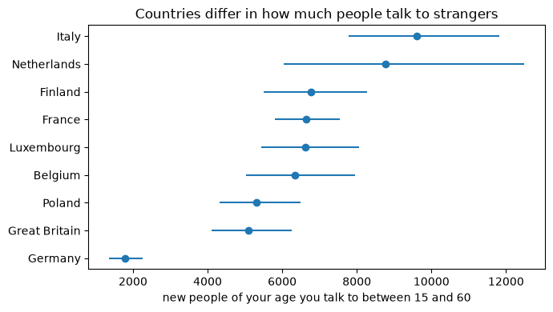
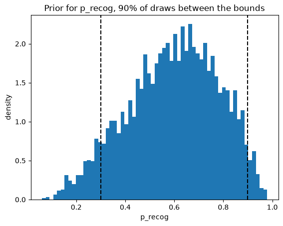
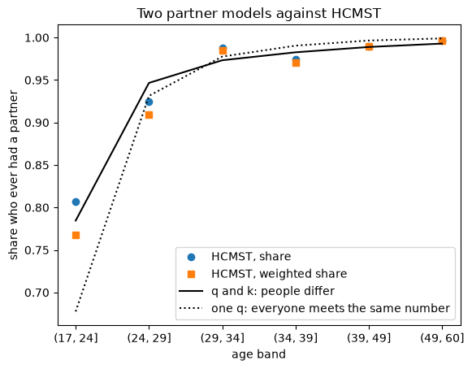

The saying goes that there is one person out there for you. I tested it with data. If it were true, your chance of ever finding that person would be about 1 in 325,800. The data on real couples points to a kinder rule. About 14 of the people your own age you will talk to could become a partner.

The idea comes from the soul mates chapter of Randall Munroe's book *What If?*. He estimated the numbers. I wanted to measure them. All the code is in the [soulmates repository](https://github.com/MedAmineGBerry/soulmates).

## The question, with small numbers first

Say your soul mate is one random person in a pool of 4 people, and in your life you meet 2 of them. If you always recognize your soul mate, your chance is 2 in 4, which is 0.5.

Now say you only recognize them half of the time. Each meeting then succeeds with chance (1/4) × 0.5 = 1/8. The chance that at least one of your 2 meetings succeeds is 1 − (7/8)² = 15/64, about 0.23.

The real calculation is the same, with bigger numbers:

```
P_find = 1 − (1 − p_recog / M) ^ N
```

M is the pool, everyone your soul mate could be. N is how many of those people you meet and talk to in your life. p_recog is the chance that you both recognize each other. When the result is tiny, it is close to N × p_recog / M. So the whole project comes down to three numbers.

## M: a pool of 1.33 billion

The premise says your soul mate is about your age. I took everyone alive in 2023 who is within 5 years of age 30. The UN World Population Prospects 2024 count them: 1,328,956,521 people.

## N: the people you meet and talk to

This number took most of the work.

In two surveys, people wrote down everyone they met on one day. POLYMOD covers 8 European countries in 2005 and 2006, and a French survey from 2012 adds a ninth. Together they give 11,107 diary days. A contact is someone you talked to face to face, for at least three words, or touched. For each contact, people said how often they usually meet that person. I count the ones marked "first time".

One detail matters more than any other. The pool only holds people within 5 years of your age, so only new people that close in age can count. That is 1 in 4 of them. My first version missed this, and fixing it made the odds about four times worse.

Here is a rough check by hand. Adults write down about 0.35 new people of their own age per day. From age 15 to 60 there are 46 years, and 0.35 × 365 × 46 is about 5,900.

The model does the same sum with more care. The rate peaks in the twenties. Weekend days bring 1.23 times as many new people. And countries differ a lot.

{fig-alt="A dot for each of nine countries with an interval line. Italy and the Netherlands are highest, Germany is lowest."}

Each country gets its own level, and the levels come from one shared distribution. Countries with few diaries borrow strength from the others. The same distribution tells me how far a country without data could sit from the average. For a person in such a country, N is about 5,800, with a wide range from 2,000 to 17,000.

I cannot tell culture from survey method here. Four countries, Germany among them, asked for an estimate of work contacts instead of a list. Part of the gap may come from that.

## p_recog: the one guess

No data exists for the chance that two soul mates recognize each other. So I state my guess as a sentence: "I am 90% sure it lies between 0.3 and 0.9."

A tool called PreliZ turns the sentence into a curve of plausible values. Many curves put 90% between 0.3 and 0.9. It picks the flattest one, so I add no certainty I do not have. The curve has an average of 0.596.

{fig-alt="A histogram of plausible values for p_recog between 0 and 1, with dashed lines at 0.3 and 0.9."}

## The odds

Now the three numbers go into the formula. N averages about 6,850. That is higher than its middle value of 5,800, because a few very talkative countries pull the average up.

```
6,850 × 0.596 / 1,328,956,521 = 0.00000307
```

That is about 1 in 325,800. The 94% interval runs from 1 in 1.5 million to 1 in 115,000.

The best case I can defend is Italy, the most talkative country, with certain recognition: 1 in 138,200. And even at the headline odds, about 4,100 people of your generation do find their one soul mate. It is rare, and it happens to someone.

## But almost everyone finds someone

A US survey of couples, How Couples Meet and Stay Together, shows that 96% of people aged 18 to 60 have had a partner. One soul mate in 1.3 billion cannot produce that.

So I turned the question around. What share of the people you talk to would have to be possible partners? I call that share q. The fit gives q = 1 in 424.

Take a first check. By age 30, the average person has met 2,725 people of their own age. If everyone met exactly that many, the chance of at least one possible partner would be 1 − (1 − 1/424)^2725 = 0.998. That is too high. Some of us talk to many strangers and some to few, so a second number, k, measures how much people differ. With k = 2.95 the chance by age 30 is 0.967, and that matches the survey.

{fig-alt="Observed shares rise from 81% at 18 to 24 to more than 99% at 50 to 60. The solid model line follows them closely. The dotted line starts too low at 68%."}

By age 60 the average person has met 5,783 people of their own age, and 5,783 / 424 is about 14. The interval runs from 10 to 19.

One cross check comes from a very different setting. In a study of speed dating at Columbia University, both people said yes after 1 in 6 of 4,189 four minute dates. Those were students who had signed up to date. Where you talk to people matters as much as how many.

## The talk

This post is the written version of a talk. The deck has 20 pages. Click into it and use the arrow keys, or [open it in its own tab](deck.html).

::: {.deck-frame}
<iframe src="deck.html" title="The talk deck: Is there really only one?" loading="lazy"></iframe>
:::

The repository also holds a small demo that plays out 1,000 lives under both rules. In a typical country, 973 of 1,000 lives had met a possible partner by age 30, and none had found their one soul mate.

## What this leaves out

- The contact diaries come from Europe between 2005 and 2012, and the couples from the US in 2017.
- The diaries are too old to see people who meet online. In the couples survey, 37% of those who met in 2010 or later met online.
- The chance of recognizing each other is a guess. It drives most of the uncertainty in the soul mate odds.
- "Had a partner" is a low bar. The 14 are people who could become a partner, which is less than a soul mate.

## Data and credits

- POLYMOD social contact data: Mossong et al. 2008, [Zenodo record 3874557](https://zenodo.org/records/3874557), licence CC BY-NC 4.0.
- Social contact data for France: Béraud et al. 2015, [Zenodo record 3886590](https://zenodo.org/records/3886590), licence CC BY-NC-ND 4.0.
- United Nations, World Population Prospects 2024, licence CC BY 3.0 IGO.
- Rosenfeld, Michael J., Reuben J. Thomas, and Sonia Hausen. 2023. How Couples Meet and Stay Together 2017-2020-2022 combined dataset. [Computer files]. Stanford, CA: Stanford University Libraries. <https://data.stanford.edu/hcmst2017>
- Speed dating: Fisman, Iyengar, Kamenica and Simonson, 2006, Quarterly Journal of Economics.
- The question: Randall Munroe, *What If?*, the chapter on soul mates.
- Tools: PyMC, ArviZ, PreliZ, marimo and Quarto.

With exactly one soul mate you would almost never find them. The data says you meet about 14 people who could be the one, so go and talk to them.
